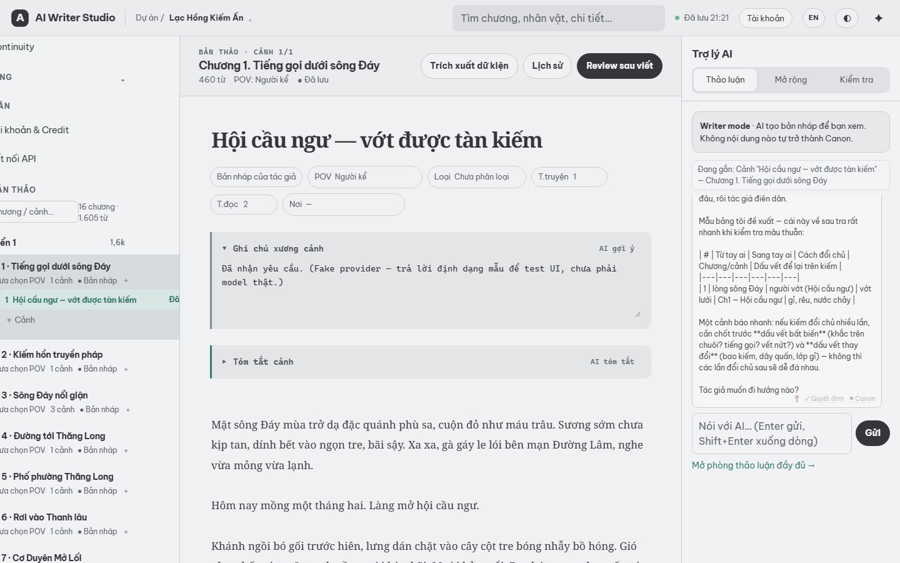
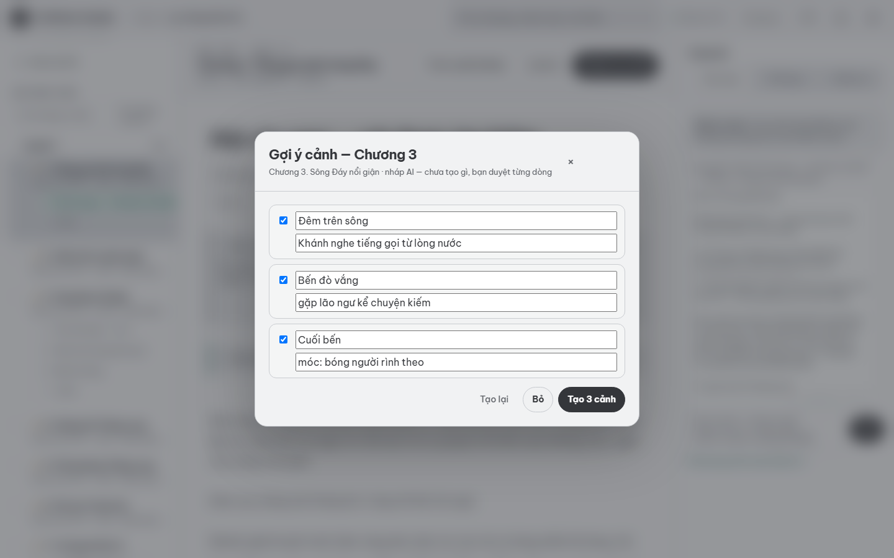
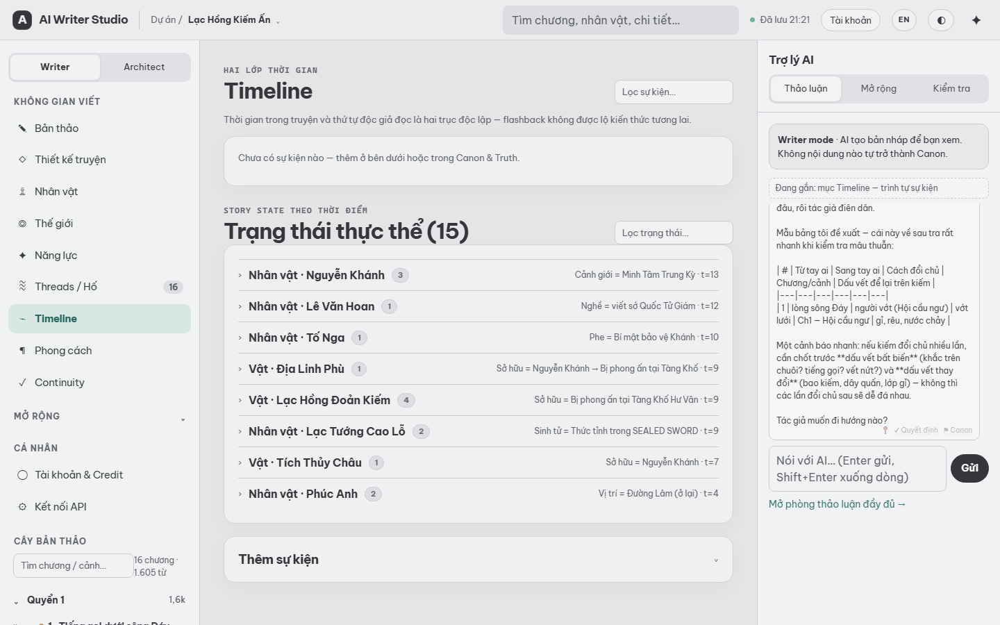

# AI Writer Studio

**A Story OS for long-form fiction where AI drafts at novel scale and the author directs like an editor-in-chief — let AI write entire arcs and chapters while you audit, or write yourself and let AI expand. Two directions, same authority.**

> Story OS cho tiểu thuyết dài kỳ theo hướng **AI viết nháp quy mô cả cuốn, tác giả đóng vai tổng biên**: đặt mục tiêu, AI viết hàng chục chương theo sóng — rồi rà continuity, sửa từng đoạn, duyệt/từ chối. Ngược lại, tự viết và nhờ AI mở rộng cũng được. Mục tiêu: ra truyện nhanh nhưng chất lượng do người chốt — mọi sản phẩm AI là bản nháp, không gì tự động thành Canon.

    



## Why another AI writing tool?

Most AI writing apps either make the model a ghostwriter you can't audit, or a chat assistant that can't produce at scale. This one makes the model a *draft factory* under an editor-in-chief:

- **AI can draft nearly the whole book.** The authoring engine writes chapters in waves — outline → scene skeletons → prose → fact extraction → summaries — with a hard stop at your target, pause/resume, and per-wave review gates. It has been dogfooded end-to-end on a real 69-chapter Vietnamese novel: generated, audited, repaired, and read like a book.
- **The author is the source of truth.** AI output is always a draft — it only becomes canon through an explicit review/approval step. Author-written prose is never silently rewritten.
- **Two directions, one tool.** Run a whole wave of chapters through the pipeline then repair — or write yourself and ask AI to discuss/expand a passage. Same authority either way.
- **Speed is the point; slop is the enemy.** The pipeline is built to catch AI's usual failure modes — POV drift, duplicated openings, forgotten threads, continuity contradictions — with deterministic checkers (code, not another LLM's opinion) and author-gated fixes. Fast generation, human taste.
- **Continuity is data, not vibes.** Characters, locations, abilities, relationships, canon facts, story states, knowledge states (who knows what, since when) and narrative threads are tracked in a story database that AI is *constrained* by — not trusted to remember.
- **Long-form scale.** Hundreds of chapters stay manageable via a volume → arc → chapter → scene hierarchy, layered summaries, repair operations that shift the whole narrative axis atomically, and context manifests that show exactly what the model received.
- **Honest about limits.** Provider capability tiers adapt prompt sizes to what your API actually tolerates; slow gateways get small windows and graceful retries instead of silent truncation.

## Features

- **Authoring engine** — long runs that write whole waves of chapters unattended: outline → scene skeletons → prose → fact extraction → summaries, hard-stop at the target chapter, pause/resume, live-editable config, per-wave review gates, auto-resolution of narrative debts when payoffs land
- **Manuscript editor** — scene-first writing with skeleton notes, briefs, autosave, POV/temporal metadata, per-scene version history with restore
- **Story database** — characters (aliases, arcs), locations, items, factions, abilities, relationships
- **Canon & truth layer** — canon facts with truth status (`CANON`/`RUMOR`/`PLANNED`), secrets, author decisions
- **Continuity engine** — 10+ deterministic checkers: canon/state conflicts, state regression, location drift, phase leak, missing extraction, restricted appearance, knowledge-leak, stale-thread, title/fact drift; post-generation issue flags
- **AI deep-check (background jobs)** — per-chapter or range AI audit → `audit_findings`; job queue with progress polling, heartbeat, orphan reaping after crashes, dedupe per scope, dismiss/reopen findings
- **Repair workflow** — insert a chapter mid-story (narrative axis shifts atomically), re-extract facts after prose edits, delete+compact a chapter, "keep this value" conflict resolution, AI fix with preview → apply
- **Selection-scoped revision** — highlight a passage, AI rewrites only that fragment with surrounding context, preview then splice back — long scenes never hit gateway timeouts
- **Thread management** — narrative-debt board with `must_resolve`/`important` priorities, auto-`RESOLVED` when the payoff is generated, dedupe on extraction
- **Timeline** — story-time vs narrative-order events, story states per entity, human-readable state rendering (VI/EN), three view modes
- **AI assistant (BYOK)** — provider/model routing per task, usage logging with latency, encrypted credentials, capability tier per key (low/standard/strong, auto-detected, overridable), streaming with stall detection + bounded concurrency
- **AI memory** — every AI call is persisted (`ai_turns`), recent scene turns are re-injected, layered `story_summaries` with coverage dashboard, relevance-ranked character/canon context with a transparent manifest
- **Author-approved AI workflows** — scene skeleton suggestions, chapter outline generation (edit/approve before scenes are created), expansion & revision drafts, scene summarization, character profile assist, per-chapter cast pinning (characters/threads/abilities/world/locations/timeline/styles)
- **What-if branches** — explore alternate storylines, preview impact, merge only through author decisions
- **Review queue** — AI-proposed canon/relationship changes wait for author approval
- **Whole-project tools** — Vietnamese-aware full-text search with deep links, JSON export / Markdown manuscript export, per-chapter reading mode
- **Vietnamese-first UI** with English translation




## Desktop app (packaging)

A production desktop build is included via two tracks:

- **Tauri 2 shell (recommended)** — `package/tauri/`: a Rust launcher that owns the backend + frontend sidecars, shows a splash while booting, lives in the system tray, kills children on exit, and ships as NSIS/MSI installers (`npx tauri build`)
- **Portable zip** — `package/`: `writer-api.exe` (PyInstaller) + `node.exe` + Next standalone `web/` + `start.bat`/`stop.bat`, built by `package/build_package.ps1`

Both run data in `%LOCALAPPDATA%/AIWriterStudio` (SQLite + encrypted secret), disable the dev `FakeProvider`, and stamp a `build_id` exposed at `/health`. See `docs/KE_HOACH_DONG_GOI.md` for the full plan and ship checklist.

## Architecture

```
frontend/       Next.js 15 + React 19 + TypeScript — writer workspace
backend/        FastAPI + SQLAlchemy 2 (async) + Alembic
                SQLite by default (writer.db) · Postgres/pgvector via docker-compose
                Provider adapters: OpenAI-compatible endpoints (OpenAI, OpenRouter,
                DeepSeek, Gemini, KiraAI, custom base URL) + Anthropic native
                + deterministic FakeProvider for dev
package/tauri/  Rust shell — sidecar lifecycle, tray, single-instance, installers
```

Key backend pieces:

| Path | Role |
|---|---|
| `app/ai/compose.py` | Prompt assembly — context manifest, session turns, ranked entities |
| `app/ai/router.py` | Model routing: project pref → account pref → fallback; provider capability tier, concurrency semaphore, retry with jitter |
| `app/services/authoring.py` | Long-run authoring engine — wave pipeline, pause/resume, target hard-stop |
| `app/services/continuity.py` | Deterministic continuity checkers |
| `app/services/memory.py` | Summaries, ancestor chain, AI turn history |
| `app/services/branch.py` | What-if branch diff/merge |
| `app/services/repair.py` | Chapter insert / re-extract / delete+compact along the narrative axis |
| `app/services/state.py` | Entity state at a point on the narrative axis |

## Quickstart

Requirements: Python 3.12+, Node 20+

```bash
# backend
cd backend
python -m venv .venv && .venv/Scripts/activate   # Windows; source .venv/bin/activate on Unix
pip install -r requirements.txt
uvicorn app.main:app --port 8000

# frontend (new terminal)
cd frontend
npm install
echo NEXT_PUBLIC_API_URL=http://localhost:8000 > .env.local
npm run dev
```

Open http://localhost:3000 → create a project, or seed the demo:

```bash
cd backend
python seed_demo.py   # ~15-chapter demo project via REST API
```

`docker-compose.yml` is included for a Postgres + Redis setup; plain SQLite works out of the box for a single local author.

## AI providers

AI features are BYOK — add a provider key in **Cài đặt → Kết nối API**. Keys are Fernet-encrypted at rest; the API only ever returns a masked hint (`••••xxxx`). In dev/test, tasks without a configured key fall back to a deterministic `FakeProvider` so the whole UI stays testable; production builds refuse to invent prose and show a clear configuration error instead.

Each credential carries a **capability tier** (`Yếu`/`Thường`/`Mạnh`) — auto-inferred from the provider, overridable per key. The tier tells the app how aggressively to split large prompts (e.g. a ~60s-capped gateway gets small deep-check windows; a strong API reads a whole chapter at once). It describes request capacity, not prose quality.

## Testing

```bash
cd backend && pytest          # 167 tests — API contracts, memory, continuity, repair, audit jobs
cd frontend && npx tsc --noEmit
```

## Next phase — Writing Hub

The next major direction extends the OS from *one manuscript* to a **multi-language, style-aware writing studio**:

- **Đa ngôn ngữ cùng lúc** — parallel language variants of the same story: one Canon/state layer shared across, e.g., a Vietnamese and an English manuscript, with side-by-side scene comparison and per-language continuity
- **Đối chiếu hành văn** — a reference library of prose traditions (Vietnamese lyrical, Japanese minimalism, Russian psychological density, French structuralism…) and famous authors' craft — analyzed along craft axes (sentence rhythm, imagery, POV discipline, dialogue economy) so the author can compare "the same scene, written differently"
- **Style profiles as constraints** — distill an author/school's craft into a style card that the context manifest can enforce — generate-in-style, then let deterministic checkers flag drift back toward generic AI voice
- **Learn-from-masters analysis** — paste or import a passage, get a craft breakdown that feeds the author's own decisions; the goal is a reference desk, not a style-cloning button

Design principle stays identical: **the author keeps authority** — style references and translations are drafts and comparisons, never silent rewrites.

## Status

Alpha, single-user local (`DEV_USER` — no real auth yet). Recently shipped: background audit jobs with heartbeat/reaping, thread priorities, chapter reference tools, Tauri desktop packaging (D1). See `docs/ROADMAP.md` and `docs/STATUS.md` for the honest state of things.

## License

MIT — see [LICENSE](LICENSE).
